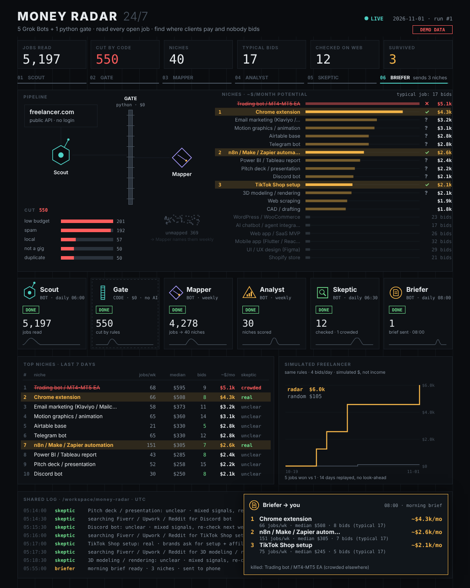

# money-radar

A team of Grok Bots that reads every open freelance job once a day and tells
you where clients are paying and almost nobody is bidding.

Plain code reads the 5,000 jobs and does the arithmetic for free. The bots
only wake up for the parts that need judgment: naming new niches, checking the
open web for competition, and writing your morning brief. Five bots, about 23
routine runs a week.



*Dashboard rendered from demo data. [Video](media/radar-demo.mp4). Your own run replaces every number.*

## What you get every morning

```
read 5,197 jobs · cut 550 · 40 niches · checked 12 · 3 survived

1. Chrome extension · ~$4.3k/mo potential · 66 jobs/week · median $508 · 8 bids (typical job: 17)
   Skeptic: real, $300-900 on Upwork, few sellers
   First move: "Chrome extension in 5 days, Manifest V3, source code included"
2. ...
killed: Trading bots (packed on Fiverr from $30)
simulated freelancer since Oct 19: radar $6.0k vs random $105 (simulated, not income)
```

## The team

| Bot | Routine | Job |
|---|---|---|
| **Scout** | daily 06:00 | runs the crawl: every open job on Freelancer's public API, ~5,000 per pass |
| **Gate** | inside Scout's run | not a bot, plain Python: cuts spam, local jobs, tiny budgets, reposts. $0 |
| **Mapper** | Sundays | names new niches in the pile nothing matched, so the radar learns new kinds of work |
| **Skeptic** | daily 06:30 | tries to kill each candidate: Fiverr sellers, Upwork proposals, Reddit asks. Max 5 checks a day, only new or changed niches |
| **Analyst** | Mondays | what's heating up and cooling down, radar health, the simulated freelancer |
| **Briefer** | daily 08:00 | the 3-niche brief with a first move for each, sent to your phone |

All bots share one cloud computer, so they hand work to each other through
files in `/workspace/money-radar`. No bot ever logs in, bids, messages
anyone, or spends money.

## Set it up in Grok Bot

1. Create a Bot named **Scout** and send it:

   ```
   Clone https://github.com/paonxeth/money-radar into /workspace/money-radar,
   then read /workspace/money-radar/team/scout.md and follow its
   "First-time setup" from start to finish. Save the skill and create the
   routine it describes. Ask me for my time zone.
   ```

2. Create four more Bots, **Skeptic**, **Briefer**, **Mapper** and
   **Analyst**, and send each one:

   ```
   Read /workspace/money-radar/team/<your name in lowercase>.md. Save the
   skill and create the routine it describes, then do one test run.
   ```

3. Optional: put all five in one group chat called "Money Radar" to watch
   them work.

That's it. Tomorrow at 08:00 the first brief arrives.

## How the numbers work

For each niche over the last 7 days of postings:

- **jobs/week**: kept jobs posted in the niche
- **median $**: median job value (mid of the budget; hourly = mid rate x 10 h)
- **bids**: median bids already on those jobs
- **typical job**: median bids across the whole market. A niche is a
  candidate only when its jobs get fewer bids than that, with at least 15
  jobs a week
- **~$/mo potential**: what one person could expect to earn in the niche
  with 20 proposals a week. You bid on the jobs with the best value /
  (bids + 1) and win each with chance 1 / (bids + 1), assuming at least 3
  rivals, never more than 2 wins a week. Expected weekly income x 30/7.
  Volume alone doesn't help: 20 proposals into jobs with 48 bids each win
  about 0.4 jobs a week. An estimate from open jobs, not a promise

**The simulated freelancer** replays every day the radar has data for. Two
paper freelancers follow identical rules (4 bids a day, win chance
0.5 / (bids + 1) with at least 3 competitors assumed, max 2 jobs at once,
paid 3 days after winning). One bids on the highest-value jobs in the radar's
top 3 niches, the other on random jobs. The top 3 for each day is computed
only from jobs posted before that day, and wins come from a fixed hash, so a
replay always gives the same answer. It's simulated money, and it uses the
latest bid counts, which makes it conservative.

## Commands

Bots call these; you can too.

| Command | |
|---|---|
| `python3 -m radar doctor` | check Python, the folder and the network |
| `python3 -m radar run` | Scout's run: crawl → gate → map → score → simulate → dashboard |
| `python3 -m radar board` | ranked niches as a table |
| `python3 -m radar queue` | what Skeptic should check today (JSON) |
| `python3 -m radar verdict ID --verdict real\|crowded\|unclear --note ... --market ...` | record a check |
| `python3 -m radar brief` | the morning brief |
| `python3 -m radar unmapped` | jobs no niche matched, for Mapper |
| `python3 -m radar taxonomy add --id ... --keywords ...` | add or fix a niche |
| `python3 -m radar weekly` | Analyst's weekly report |
| `python3 -m radar ingest FILE --source NAME` | jobs a bot collected with its browser from a site without an API |
| `python3 -m radar export` | `data/out/data.json` + a self-contained `dashboard.html` |
| `python3 -m radar --home /tmp/demo demo` | try everything on demo data |

Python 3.9+, standard library only. Nothing to install. Tests:
`python3 -m unittest discover -s tests`.

Settings live in `data/config.json` (any key from `radar/config.py`), the
niche list in `data/taxonomy.json`, everything else in one SQLite file.

## Render the video

`data/out/dashboard.html` plays the run as an animation. To turn it into a
60 fps mp4 (needs Node, ffmpeg, Chromium):

```
npm install && npx playwright install chromium
node video/capture.cjs --data /workspace/money-radar/data/out/data.json --out radar.mp4
```

The animation is a pure function of time, so every frame is exact.

## Honest limits

- One source with a public API (Freelancer). Other sites go through the
  browser and `radar ingest`, and some block cloud IPs or show CAPTCHAs; the
  bots stop there instead of working around it.
- Freelancer's search stops paging around 5,000 results. Add
  `crawl_queries` in config to go past it.
- The first week sees only jobs that are still open. Week-over-week trends
  switch on after 7 days of daily runs.
- "Potential" and the simulated freelancer are estimates. Winning real work
  takes a profile, reviews and good proposals.

## License

MIT
